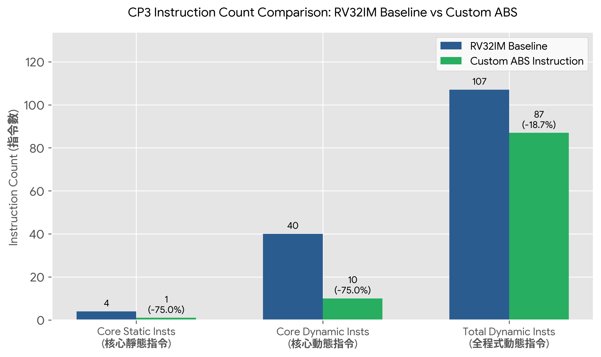

# Checkpoint 3 報告：ABS 指令規格與編碼

## 1. 本次目標
本 Checkpoint 的目標為定義客製化 RISC-V `abs` 指令之語意規格、完成 R-type 指令格式編碼與欄位對應，並透過 3 組測試範例（含 `INT32_MIN` 溢位極限值）進行機器碼手動拆解，最後評估客製化指令相較於 CP2 RV32IM Baseline 之指令數節省效益。

## 2. 設計內容

### ABS (絕對值) 指令語意規格
- **語意(公式)**：$rd = |rs1|$
- **運算元與定義域**：一元運算，使用 `$rs1$` 暫存器；$rs1 \in [-2^{31}, 2^{31}-1]$ (32-bit signed integer)。
- **結果範圍**：$rd \in [0, 2^{31}-1]$ (一般情況)；邊界極限時為 $-2^{31}$。
- **邊界條件與溢位處理**：當 $rs1 = -2147483648$ (`INT32_MIN` / `0x80000000`) 時，$rs1$ 取絕對值會發生 32-bit 二補數溢位。依據課程規格，此狀況採取 32-bit wrap-around 處理，運算結果仍為 $-2147483648$ (`0x80000000`)。
- **測試向量(至少 3 組,含 1 組邊界值)**：
  1. $rs1 = -5 \rightarrow rd = 5$ (一般負數)
  2. $rs1 = 100 \rightarrow rd = 100$ (一般正數)
  3. $rs1 = -2147483648 \rightarrow rd = -2147483648$ (邊界極限 wrap-around)
- **對應的 RV32IM baseline 片段與指令數**：
```assembly
srai t0, a0, 31    # 1
xor  a0, a0, t0    # 2
sub  a0, a0, t0    # 3
ret                # 4 (含控制返回)
```
  對應之 RV32IM baseline 靜態指令數為 `4` 條（核心邏輯 `3` 條 + `ret` `1` 條）。

### 指令編碼與欄位說明 (R-type Format)
本專題將 `abs` 指令劃分於 RISC-V 保留之 `custom-0` 空間（`opcode = 0001011` / `0x0B`）：

| 欄位名稱 | 位元範圍 | 設定值 | 說明 |
|---|---|---|---|
| `funct7` | `[31:25]` | `0000000` (`0x00`) | 客製化操作碼擴充 |
| `rs2` | `[24:20]` | `00000` (`x0`) | 未使用（一元運算固定設為 `0`） |
| `rs1` | `[19:15]` | `src` 暫存器 | 輸入來源暫存器 |
| `funct3` | `[14:12]` | `000` (`0x0`) | 指令次功能碼 |
| `rd` | `[11:7]` | `dest` 暫存器 | 輸出結果暫存器 |
| `opcode` | `[6:0]` | `0001011` (`0x0B`) | `custom-0` 標準 Opcode |

### C 語言虛擬碼 (Behavioral Simulation)
```c
int32_t abs_custom(int32_t rs1) {
    if (rs1 == INT32_MIN) {
        return INT32_MIN; // 0x80000000 wrap-around
    }
    return (rs1 < 0) ? -rs1 : rs1;
}
```

## 3. 結果與分析

### 機器碼與欄位拆解 (3 個範例)
手動拆解 3 組測試範例之機器碼與暫存器欄位分配：

1. **範例一 (一般負數)**：`abs x10, x11` ($rs1 = x11 = -5$)
   - `funct7`: `0000000`
   - `rs2`: `00000`
   - `rs1`: `01011` (`x11`)
   - `funct3`: `000`
   - `rd`: `01010` (`x10`)
   - `opcode`: `0001011`
   - 二進位機器碼：`0000000_00000_01011_000_01010_0001011` $\rightarrow$ 十六進位：`0x0005850B`

2. **範例二 (一般正數)**：`abs x10, x12` ($rs1 = x12 = 100$)
   - `funct7`: `0000000`
   - `rs2`: `00000`
   - `rs1`: `01100` (`x12`)
   - `funct3`: `000`
   - `rd`: `01010` (`x10`)
   - `opcode`: `0001011`
   - 二進位機器碼：`0000000_00000_01100_000_01010_0001011` $\rightarrow$ 十六進位：`0x0006050B`

3. **範例三 (邊界極限值)**：`abs x10, x13` ($rs1 = x13 = -2147483648$)
   - `funct7`: `0000000`
   - `rs2`: `00000`
   - `rs1`: `01101` (`x13`)
   - `funct3`: `000`
   - `rd`: `01010` (`x10`)
   - `opcode`: `0001011`
   - 二進位機器碼：`0000000_00000_01101_000_01010_0001011` $\rightarrow$ 十六進位：`0x0006850B`

### 指令數比較表 (CP2 Baseline vs Custom ABS)
- **計數方法**：靜態指令數（代碼行數與反組譯碼）與動態指令數（實際執行數量）
- **模擬器工具與版本**：Ripes v2.2.6 (5-Stage Pipeline Processor)

| 評估指標 | CP2 RV32IM Baseline | CP3 Custom ABS 指令 | 效益提升 (%) |
|---|---|---|---|
| **函式核心靜態指令數** | `4` 條 (含 `ret`) | `1` 條 (`abs`) | **減少 75.0%** |
| **函式核心動態指令數 (10次)** | `40` 條 (4×10) | `10` 條 (1×10) | **減少 75.0%** |
| **全程式總動態指令數** | `107` 條 | `87` 條 | **減少 18.7%** |



## 4. 遭遇的問題與解法
在進行 R-type 指令格式編碼時，由於 `abs` 指令屬於僅需單一來源暫存器（`rs1`）的一元運算，而專題規範之 R-type 格式包含兩個來源暫存器欄位（`rs1` 與 `rs2`）。為遵循 RISC-V 指令集編碼規範並維持硬體譯碼器（Decoder）控制線路的簡潔性，我們將未使用的 `rs2` 欄位（bit 24:20）明確固定填為 `00000` (`x0`)。此外，在對 `INT32_MIN` (`-2147483648`) 邊界極限值進行機器碼手動拆解時，需特別核對暫存器索引位元（如 `x13` 對應 `01101`）與 `custom-0` Opcode (`0x0B`) 的欄位對齊，確保對照表計算結果精準無誤。

## 5. 白話說明
這次 CP3 我們為 RISC-V 加裝了一個專屬的「絕對值快捷鍵」`abs`。原本算出一個數字的絕對值需要經過「右移、異或、相減、返回」一共 4 個步驟；現在只要呼叫一次全新的 `abs` 指令，CPU 就能在單一指令內搞定。這讓我們的絕對值計算指令數量一口氣減少了 75%！

## 6. AI 使用說明
- **工具名稱**：ChatGPT / Gemini
- **用途與時機**：協助進行 Custom-0 R-type 指令位元欄位計算、機器碼二進位轉十六進位驗證，以及繪製視覺化指令數比較圖表。
- **本組修改處**：手動核對各暫存器編號 (`x10`, `x11`, `x12`, `x13`) 之對應位元，修正第四區塊遭遇問題與解法之描述，並確認 `INT32_MIN` 邊界極限值機器碼拆解正確無誤。